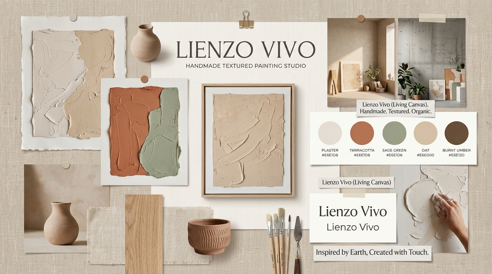

# Moodboard — Lienzo Vivo

**Tablero Whimsical:** https://whimsical.com/lienzo-vivo-moodboard-art-studio-sample-board

## Palabras clave

Texturado · Orgánico · Cálido · Contemporáneo · Sereno

## Qué sensación buscamos

Queremos que **Lienzo Vivo** transmita la serenidad y riqueza de un taller de arte contemporáneo: tonos tierra suaves, texturas de yeso y arena modelada a mano, madera de roble natural, lino crudo y cerámica artesanal. 

A Sofía le apasionan los espacios elegantes y acogedores (*japandi* y minimalismo cálido), pero le frustra la frialdad de las impresiones digitales masivas. La estética de Lienzo Vivo le transmite tranquilidad, autenticidad y sofisticación artesanal, demostrándole que cada obra aporta luz, sombras dinámicas y volumen a sus muros.
