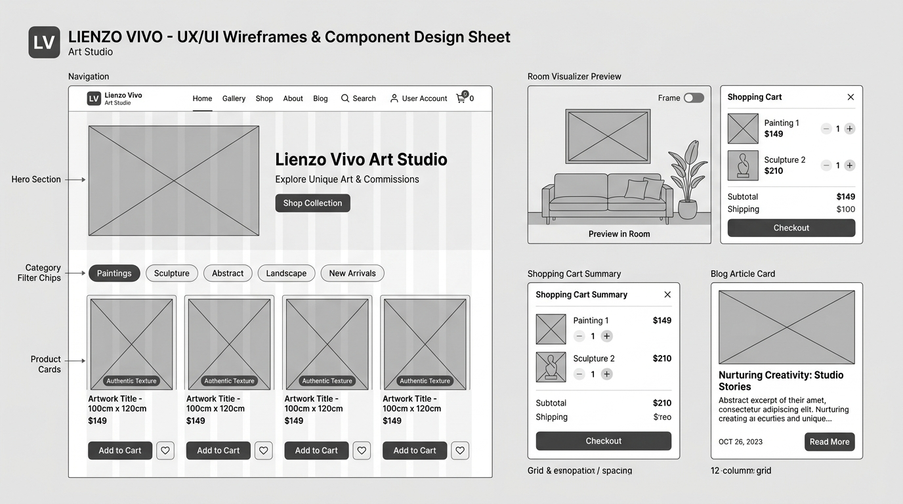

# Calco de componentes en Whimsical — Lienzo Vivo

**Tablero Whimsical:** https://whimsical.com/lienzo-vivo-ui-components-wireframe-board

## Tabla de componentes calcados

| Componente | Referencia | Qué contiene | Qué necesidad de Sofía resuelve |
|---|---|---|---|
| **Navbar de Galería** | Galería Singulart | Logotipo tipográfico "Lienzo Vivo", enlaces (Tienda, Obras a Medida, Blog, Taller), barra de búsqueda integrada e ícono de carrito con contador badge | Sofía accede de inmediato al catálogo de cuadros y revisa su carrito desde cualquier página con un solo toque. |
| **Hero de Impacto Visual** | Kave Home Studio | Título editorial con tipografía serif, bajada con propuesta de valor, botón principal "Explorar Galería", botón secundario "Obras a Medida" y fotografía en gran angular de cuadro texturado sobre sofá | Entiende en menos de 5 segundos que son cuadros hechos a mano con relieve y puede ingresar a ver la colección disponible. |
| **Product Card de Obra (`card-product`)** | Westwing Fine Art | Imagen en alta definición de la obra, etiqueta distintiva de técnica ("Textura en Relieve" / "Óleo sobre Lino"), nombre de la obra, dimensiones en cm, precio en CLP y botón "Ver Obra & Medidas" | Permite a Sofía ver de un vistazo el precio, la técnica artesanal y las medidas exactas sin tener que abrir cada ficha. |
| **Filtros de Catálogo (`filter-bar`)** | Zara Home Arte & Deco | Chips de categorías horizontales (Texturados, Botánicos, Abstractos, Dípticos), selector desplegable de orientación y selector de paleta de color dominante | Le ahorra tiempo al filtrar rápidamente los cuadros que combinan con la orientación de su pared y la gama de colores de su living. |
| **Selector de Enmarcado & Medidas (`frame-selector`)** | Desenio Gallery Art | Muestras interactivas con foto de bastidor simple, marco flotante de roble natural y marco negro mate con desglose de precio adicional | Sofía puede personalizar el acabado de la madera para que combine a la perfección con los demás muebles de su proyecto. |
| **Visualizador en Muro (`room-visualizer`)** | Artfinder Room Preview | Escala proporcional del cuadro sobre un sofá estándar de 3 cuerpos con interruptor para alternar color de muro (blanco cálido, arena o gris suave) | Elimina la frustración y el miedo a equivocarse con la proporción del cuadro en su sala. |
| **Formulario de Captación de Leads (`lead-form`)** | Studio McGee | Título con oferta atractiva, campos de nombre y correo electrónico, botón principal "Descargar Guía + 10% Dcto" y microtexto de privacidad | Permite a Sofía obtener la guía técnica de proporciones de decoración y probar la marca con un beneficio exclusivo. |
| **Card de Artículo de Blog (`article-card`)** | Architectural Digest México | Imagen de cabecera con proporción 16:9, etiqueta de categoría, título reflexivo, tiempo estimado de lectura (ej. "4 min") y enlace "Leer guía completa" | Facilita encontrar consejos de diseño e interiorismo para complementar la ambientación de su hogar. |
| **Resumen del Carrito & Despacho (`cart-summary`)** | Pottery Barn E-commerce | Lista de obras seleccionadas con foto y tipo de marco, calculador de despacho por comuna con opción de embalaje reforzado de madera, subtotal y botón "Proceder al Pago Seguro" | Otorga total certeza y transparencia sobre el costo final de envío y la seguridad de traslado de la obra antes de pagar. |
