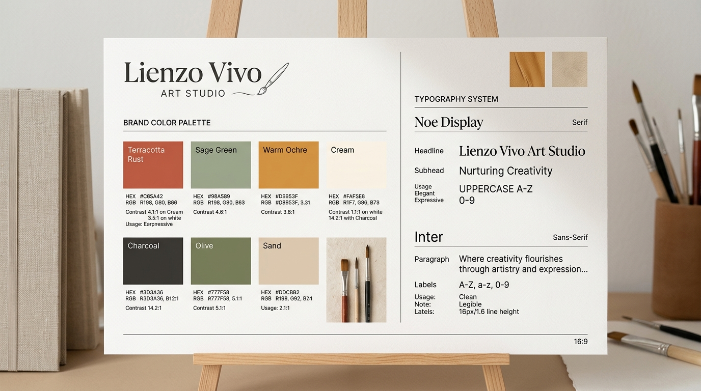

# Color y tipografía — Lienzo Vivo

## Paleta de color

| Rol | Nombre del color | Código HEX | Uso en el diseño |
|---|---|---|---|
| **Principal** | Terracota Arcilla | `#B85D36` | Botones de acción principales, enlaces destacados, acentos de identidad |
| **Principal Hover** | Terracota Tostado | `#9C4A26` | Estado hover de botones primarios y enlaces activos |
| **Secundario** | Verde Salvia Cálido | `#4A6B56` | Fondos de secciones destacadas, badges de técnica artesanal, acentos botánicos |
| **Acento** | Ocre Dorado Tierra | `#C88A3E` | Etiquetas de novedad, íconos de textura y detalles ornamentales |
| **Acento Fuerte** | Ocre Profundo | `#9E6723` | Fondo de badges con texto blanco (garantiza contraste AA) |
| **Fondo General** | Lino Crudo / Crema | `#FAF7F2` | Fondo principal de todas las páginas (calidez visual sin deslumbrar) |
| **Superficie / Cards**| Arena Suave | `#F0EAE1` | Fondo de tarjetas de producto, cajas de contenido y barras de filtro |
| **Bordes y Divisores**| Trazo de Yeso | `#DFD5C7` | Líneas divisorias sutiles y bordes de tarjetas |
| **Texto Principal** | Carbón Profundo | `#262320` | Títulos, encabezados y cuerpo de texto principal |
| **Texto Secundario** | Ceniza Cálida | `#665F58` | Textos secundarios, descripciones técnicas, medidas y metadatos |
| **Éxito** | Verde Musgo | `#3B7A57` | Mensajes de confirmación y stock disponible |
| **Error** | Rojo Arcilla Óxido | `#B3392E` | Validaciones de formulario y alertas de error |

---

## Verificación de contraste (WCAG 2.1 - Nivel AA)

| Combinación de color | Ratio de contraste | Cumplimiento | Observaciones de uso |
|---|---|---|---|
| Texto Carbón (`#262320`) sobre Fondo Crema (`#FAF7F2`) | **14.8:1** | AAA ✅ | Máxima legibilidad en lecturas largas y fichas de producto |
| Texto Carbón (`#262320`) sobre Fondo Arena (`#F0EAE1`) | **12.6:1** | AAA ✅ | Óptimo para tarjetas de producto y contenedores |
| Texto Blanco (`#FFFFFF`) sobre Terracota (`#B85D36`) | **4.9:1** | AA ✅ | Botones primarios y llamadas a la acción (CTA) |
| Texto Blanco (`#FFFFFF`) sobre Terracota Tostado (`#9C4A26`) | **6.6:1** | AAA ✅ | Estado hover de botones principales |
| Texto Blanco (`#FFFFFF`) sobre Verde Salvia (`#4A6B56`) | **4.7:1** | AA ✅ | Badges de técnica artesanal y banners secundarios |
| Texto Blanco (`#FFFFFF`) sobre Ocre Profundo (`#9E6723`) | **4.8:1** | AA ✅ | Etiquetas de descuento y sellos de autor |
| Texto Ceniza Cálida (`#665F58`) sobre Fondo Crema (`#FAF7F2`) | **5.4:1** | AA ✅ | Medidas, autoría y textos complementarios |

---

## Tipografía (Google Fonts)

- **Tipografía para títulos y encabezados:** `Fraunces` (Google Fonts) — Una tipografía serif cálida, contemporánea y expresiva con curvas orgánicas inspiradas en la artesanía y el diseño editorial.
- **Tipografía para cuerpo y datos:** `Inter` (Google Fonts) — Una tipografía sans-serif de precisión geométrica con excelente legibilidad en pantallas retina y dispositivos móviles pequeños.

### Escala tipográfica

| Elemento HTML | Tamaño Desktop | Tamaño Mobile | Peso (Weight) | Altura de línea (Line Height) |
|---|---|---|---|---|
| **h1 (Hero / Títulos principales)** | `3.0rem` (48px) | `2.125rem` (34px) | 600 (SemiBold) | 1.15 |
| **h2 (Títulos de sección)** | `2.125rem` (34px) | `1.625rem` (26px) | 600 (SemiBold) | 1.25 |
| **h3 (Títulos de tarjeta y módulos)** | `1.375rem` (22px) | `1.25rem` (20px) | 600 (SemiBold) | 1.30 |
| **Párrafo principal / Bajadas** | `1.125rem` (18px) | `1.0rem` (16px) | 400 (Regular) | 1.60 |
| **Cuerpo de texto regular** | `1.0rem` (16px) | `0.9375rem` (15px) | 400 (Regular) | 1.60 |
| **Textos pequeños / Badges / Meta** | `0.8125rem` (13px) | `0.75rem` (12px) | 500 (Medium) | 1.40 |
| **Botones y enlaces CTA** | `1.0rem` (16px) | `0.9375rem` (15px) | 600 (SemiBold) | 1.00 |

---

## Justificación desde el Moodboard y la Proto-Persona

La paleta cromática se extrae directamente de las materias primas del taller: el **terracota** evoca los pigmentos minerales y la arcilla de modelado; el **verde salvia** aporta serenidad botánica y equilibrio; el **arena y lino crema** recrean la calidez del bastidor de tela cruda, evitando el blanco digital frío y hospitalario.

Para Sofía, que suele navegar desde su smartphone en horarios nocturnos tras largas jornadas laborales, el fondo crema suave relaja la vista. La tipografía **Fraunces** transmite la elegancia y autenticidad de una galería de autor, mientras que **Inter** le garantiza una lectura fluida y nítida de medidas, tipos de enmarcado y políticas de despacho.
